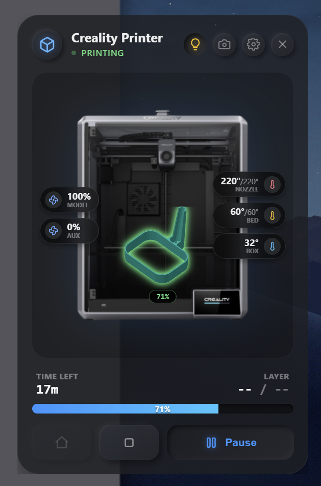
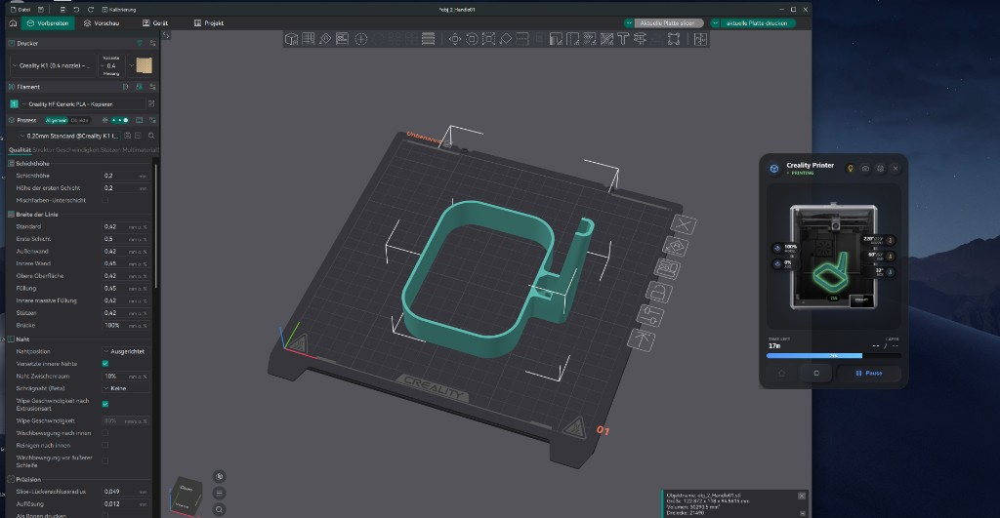

# Glance3D

A lightweight, always-on-top Windows desktop widget for live **Creality / Klipper / Moonraker** printer status. Styled like a glass Prism card — no Home Assistant required. Works alongside [Orca Slicer](https://github.com/SoftFever/OrcaSlicer): start a print from Orca, and Glance3D follows the same Moonraker feed.

<p align="center">
  
</p>

<p align="center">
  <em>Live nozzle/bed/chamber temps, fans, progress, time left, and pause/stop/home — floating over your desktop.</em>
</p>

<p align="center">
  
</p>

<p align="center">
  <em>Designed to sit next to Orca Slicer while you slice and print.</em>
</p>

---

## Features

- **Live status** — printing / paused / idle / offline with progress bar and ETA  
- **Temperatures** — nozzle, bed, and chamber at a glance  
- **Fans & light** — model / aux fan readouts and printer LED toggle  
- **Camera** — MJPEG stream from the printer (when available)  
- **Controls** — pause / resume, cancel, home (`G28`)  
- **Desktop-first UX** — frameless, transparent, always on top, drag to move, optional click-through  
- **Smart visibility** — optionally show the window only while a print is running  
- **Windows autostart** — keep the widget ready in the background after login  

## Requirements

- Windows 10/11 with WebView2  
- A printer running **Klipper + Moonraker** on your LAN (e.g. rooted Creality K1)  
- Network access to Moonraker (default port `7125`)

## Quick start

### Run a release build

```bash
npm install
npm run tauri build
```

The portable app is written to:

`src-tauri/target/release/orca-widget.exe`

Installers (optional):

- `src-tauri/target/release/bundle/nsis/Orca Widget_0.1.0_x64-setup.exe`
- `src-tauri/target/release/bundle/msi/Orca Widget_0.1.0_x64_en-US.msi`

### Development

```bash
npm install
npm run tauri dev
```

Open **Settings** (gear icon), set your Moonraker host/port, and save.

## Settings that matter for Orca

| Option | What it does |
|--------|----------------|
| **Start with Windows (background)** | Launches Glance3D at login so it can stay hidden until needed |
| **Show only while printing** | Hides the window when idle; shows it when Moonraker reports an active print (including jobs started from Orca) |

Use **both** if you want the widget to appear automatically when a print starts without keeping it visible all day. “Show only while printing” does not launch the process by itself — the app must already be running.

## Tech stack

- [Tauri 2](https://v2.tauri.app/) — transparent, always-on-top Windows shell  
- Vite + TypeScript + [Lit](https://lit.dev/) — UI  
- Rust WebSocket proxy to Moonraker (avoids packaged-app CORS/`Origin` issues)  
- Plugins: store, HTTP, autostart, global shortcut  

Deeper architecture notes: [`orca-widget.md`](./orca-widget.md).

## License

Private / all rights reserved unless otherwise noted by [BangerTech](https://github.com/BangerTech).
