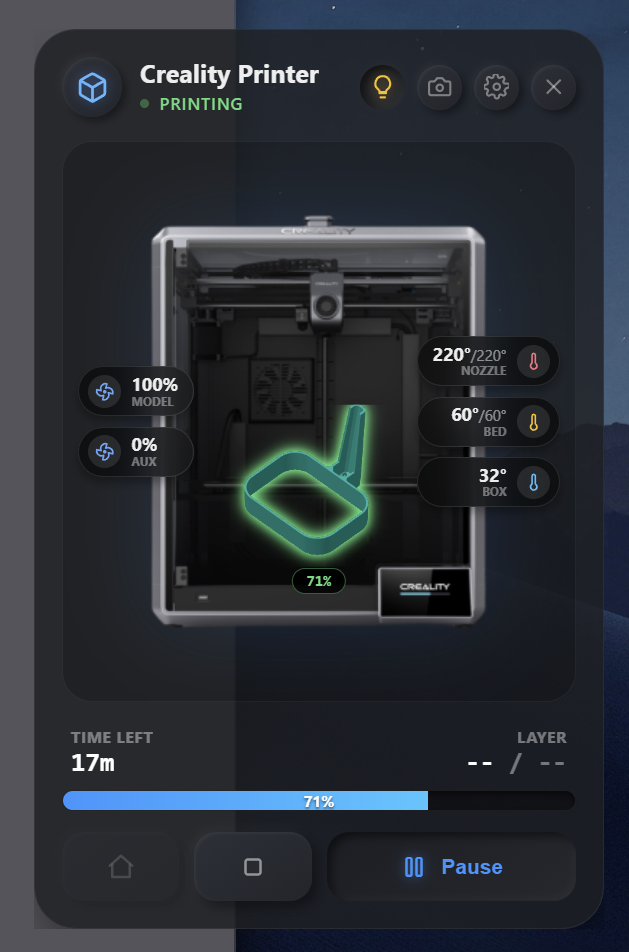
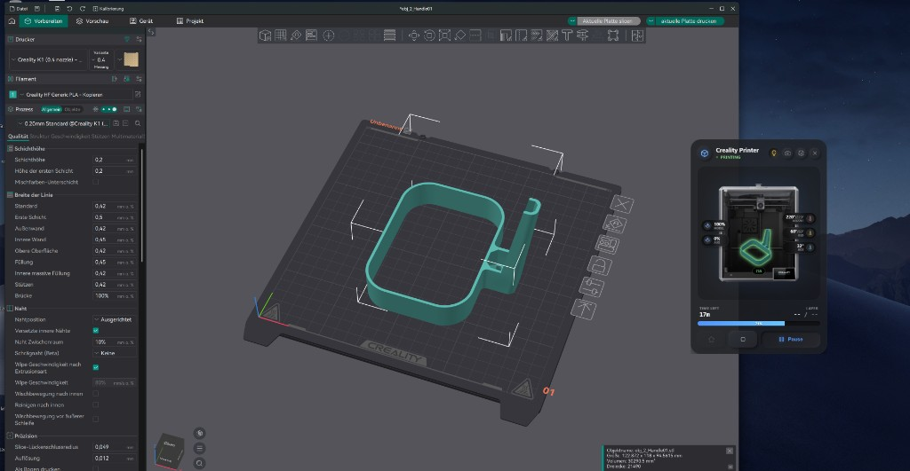

# Glance3D

A lightweight, always-on-top Windows desktop widget for live 3D printer status. Styled like a glass Prism card — no Home Assistant required. One freely placeable window per printer, side-by-side on your desktop.

Supported backends:

- **Creality / Klipper / Moonraker** over WebSocket JSON-RPC — works alongside [Orca Slicer](https://github.com/SoftFever/OrcaSlicer): start a print from Orca and Glance3D follows the same Moonraker feed.
- **Bambu Lab** (P1S, P1P, P2S, X1 / X1C / X1E, X2D, A1 / A1 mini, A2L, H2D / H2D Pro, H2S, H2C and the new **H3C**) over the printer's local MQTT/TLS protocol (LAN Only Mode + Developer Mode).

<p align="center">
  
</p>

<p align="center">
  <em>Live nozzle/bed/chamber temps, fans, progress, time left, and pause/stop/home — floating over your desktop.</em>
</p>

<p align="center">
  
</p>

<p align="center">
  <em>Designed to sit next to Orca Slicer while you slice and print.</em>
</p>

---

## Features

- **Multi-printer, multi-window** — one freely placeable widget per printer; mix Creality and Bambu side-by-side  
- **Live status** — printing / paused / idle / offline with progress bar and ETA  
- **Temperatures** — nozzle, bed, and chamber at a glance (model-aware: hidden on models without a sensor)  
- **Fans & light** — part / aux / exhaust fan readouts and printer LED (chamber light) toggle  
- **Model-aware Bambu support** — the full catalog (P/X/A/H series) with capability flags, including the new **H3C** (AMS 3H with 9 slots, hotend rack, 65 °C heated chamber)  
- **AMS / CFS units** — grouped per unit with humidity + temperature badge; per-slot grams-left from the Bambu RFID tag, Bambu's own color names ("Grass Green"), and the external spool  
- **Print-speed selector** — Silent / Standard / Sport / Ludicrous for Bambu  
- **Readable stages** — German stage names for `stg_cur` ("Heizt Hotend", "Pausiert: Filament leer", ...)  
- **Error banner** — Bambu HMS + `print_error` resolved to localized texts (German primary, English fallback)  
- **Hardened Bambu TLS** — verifies the printer's leaf-CN equals the configured serial and the chain roots at a bundled Bambu CA  
- **LAN discovery** — "Drucker im Netzwerk suchen" scans UDP 2021 (SSDP-style) and fills host / serial / model into the add-printer form  
- **Camera** — MJPEG stream for Moonraker (RTSP for Bambu coming in a later release)  
- **Controls** — pause / resume, cancel, home (`G28`)  
- **Desktop-first UX** — frameless, transparent, always on top, drag to move, optional click-through  
- **Smart visibility** — optionally show the window only while a print is running  
- **Windows autostart** — keep the widget ready in the background after login  

## Requirements

- Windows 10/11 with WebView2  
- Either (or both):
  - A printer running **Klipper + Moonraker** on your LAN (e.g. rooted Creality K1) — port `7125`
  - A **Bambu Lab** printer with **LAN Only Mode + Developer Mode** enabled (grab the 8-digit Access Code + Serial from the printer screen) — port `8883`

## Quick start

### Run a release build

```bash
npm install
npm run tauri build
```

The portable app is written to:

`src-tauri/target/release/glance3d.exe`

Installers (optional):

- `src-tauri/target/release/bundle/nsis/Glance3D_0.3.0_x64-setup.exe`
- `src-tauri/target/release/bundle/msi/Glance3D_0.3.0_x64_en-US.msi`

### Development

```bash
npm install
npm run tauri dev
```

Open **Settings** (gear icon), set your Moonraker host/port, and save.

## Managing printers

The gear icon on any printer card opens the settings panel for that printer. From there you can:

- Edit the printer's name, type (**Creality / Moonraker** or **Bambu Lab**), connection, camera URL, and visibility toggles
- Switch to another printer's window
- **Add** a new printer (Moonraker or Bambu) — opens as a new window
- **Remove** the current printer (closes its window)

The app keeps running as long as any printer is configured, even if you close every window — reopen from the system tray / startup.

## Settings that matter for Orca

| Option | What it does |
|--------|----------------|
| **Start with Windows (background)** | Launches Glance3D at login so it can stay hidden until needed |
| **Show only while printing** | After a print has finished, hides the window until the next job; stays visible on launch / while offline so Settings remain reachable |

Use **both** if you want the widget to appear automatically when a print starts without keeping it visible all day. “Show only while printing” does not launch the process by itself — the app must already be running.

## Tech stack

- [Tauri 2](https://v2.tauri.app/) — transparent, always-on-top Windows shell with runtime window spawning  
- Vite + TypeScript + [Lit](https://lit.dev/) — UI  
- Rust transport layer:
  - `tokio-tungstenite` WebSocket proxy for Moonraker (avoids packaged-app CORS/`Origin` issues)  
  - `rumqttc` + `rustls` MQTT/TLS driver for Bambu Lab (accepts the printer's self-signed cert)  
- Plugins: store, HTTP, autostart, global shortcut  

Deeper architecture notes: [`glance3d.md`](./glance3d.md).

## Attribution

The Bambu Lab path adopts MIT-licensed protocol logic and bundled data from
[rolottr/bambu-bar](https://github.com/rolottr/bambu-bar) (by NINA LABS):
the report parser, the model catalog + capability flags, the per-slot grams /
colorName logic, the stage-name table, the HMS/error text catalogs (via
[ha-bambulab](https://github.com/greghesp/ha-bambulab)), the filament preset
catalog, and the device CAs used for TLS. See
[`glance3d.md`](./glance3d.md#attribution) and individual file headers for
details.

## License

Private / all rights reserved unless otherwise noted by [BangerTech](https://github.com/BangerTech).
